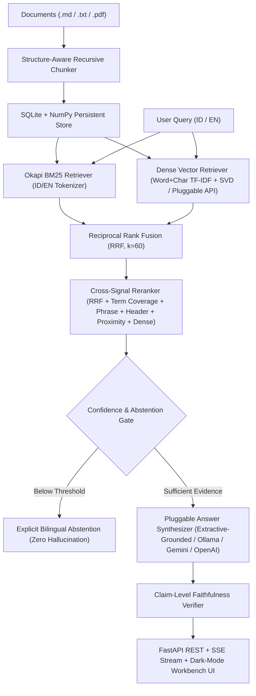

# Hybrid RAG Eval

Production-grade **Hybrid Retrieval-Augmented Generation (RAG) & Automated Evaluation Engine** featuring **Okapi BM25 + Dense Vector search**, **Reciprocal Rank Fusion (RRF)**, **Cross-Signal Reranking**, **strict inline `[doc_id#chunk_id]` citation grounding with automatic abstention**, **Server-Sent Events (SSE) streaming**, a built-in dark-mode **RAG Workbench UI**, and a reproducible **BM25 vs Dense vs Hybrid** benchmark suite.

Runs **100% offline out-of-the-box** with zero paid API keys required, while providing clean pluggable adapters for **Ollama**, **Google Gemini**, and **OpenAI** via environment variables.

---

## Architecture



---

## Key Features

- **Structure-Aware Recursive Chunker (`chunking.py`)**: Parses `.md`, `.txt`, and `.pdf` (via PyMuPDF with `pypdf` fallback), preserving hierarchical Markdown heading breadcrumbs (`Section > Subsection`), page numbers, character offsets, and word-boundary overlap.
- **True Hybrid Retrieval (`retrieval.py`)**:
  - **Okapi BM25 (`k1=1.5, b=0.75`)** with bilingual Indonesian/English tokenization, colloquial slang normalization (`yg -> yang`, `dgn -> dengan`, `perlindungan -> pelindungan`), and Lucene-style non-negative IDF.
  - **Dense Vector Retriever** combining word n-grams + `char_wb` (3–5) subword TF-IDF projected via `TruncatedSVD` and L2-normalized into dense vectors for offline semantic & morphological matching, with pluggable `Ollama`, `Gemini`, and `OpenAI` embedding backends.
  - **Reciprocal Rank Fusion (RRF)** (`1 / (k + rank)`) retaining per-stage rank and score explainability.
  - **Cross-Signal Reranker** scoring candidate chunks across 6 interpretable signals: `rrf_norm`, IDF-weighted `term_coverage`, `dense_sim`, `phrase_boost`, `title_section_match`, and sliding-window `proximity`.
  - **Live Mode Switching**: Compare `bm25`, `dense`, and `hybrid` on the same query via API or UI.
- **Strict Citation Grounding & Automatic Abstention (`grounding.py`)**:
  - Enforces explicit inline `[doc_id#chunk_id]` citations on every factual claim.
  - Post-verifies every claim sentence against its cited chunk(s) to compute `faithfulness_score` (`supported_claims / total_claims`).
  - Automatically abstains in Indonesian or English when evidence confidence falls below threshold instead of fabricating answers.
- **Persistent SQLite + NumPy Store (`store.py`)**: Atomic document/chunk upserts, SHA-256 content hashing, cascade deletes, and compressed `.npz` vector artifacts.
- **Interactive Dark-Mode RAG Workbench (`GET /`)**: Mode switcher, live SSE token streaming, clickable citations highlighting evidence chunks, per-hit signal bars, `.md`/`.txt`/`.pdf` ingestion modal, and live evaluation benchmark chart.

---

## Measured Benchmark Results (`eval/run_eval.py`)

Evaluated on `eval/qa_dataset.json` (**32 curated bilingual queries**: 26 answerable across 6 Indonesian & English enterprise documents + 6 unanswerable out-of-domain queries; **6 documents, 55 chunks**, offline `extractive-grounded` + `local-svd` mode):

| Mode | Recall@3 | Recall@5 | MRR | NDCG@5 | Citation Faithfulness | Keyword Recall | Abstention Acc | Latency p50 / p95 (ms) |
| :--- | :---: | :---: | :---: | :---: | :---: | :---: | :---: | :---: |
| BM25 | 100.0% | 100.0% | 1.000 | 0.870 | 100.0% | 83.0% | 96.9% | 10.07 / 11.18 |
| DENSE | 100.0% | 100.0% | 1.000 | 0.881 | 100.0% | 83.0% | 96.9% | 10.29 / 12.33 |
| **HYBRID (RRF+Rerank)** | **100.0%** | **100.0%** | **1.000** | **0.885** | **100.0%** | 82.0% | **96.9%** | 15.51 / 17.37 |

Reproduce anytime:

```bash
python eval/run_eval.py
```

Results are saved to [`eval/latest_report.json`](eval/latest_report.json) and served live at `GET /v1/eval/latest`.

---

## Quickstart

### 1. Local Python (Offline Ready)

```bash
python -m venv .venv
# Linux/macOS: source .venv/bin/activate
# Windows PowerShell: .venv\Scripts\Activate.ps1

pip install -r requirements.txt
cp .env.example .env

# Run automated benchmark
python eval/run_eval.py

# Start FastAPI server + Dark-Mode Web UI
uvicorn hybrid_rag.api:app --app-dir src --reload --port 8000
```

Open:
- **RAG Workbench UI**: http://localhost:8000/
- **OpenAPI Swagger Docs**: http://localhost:8000/docs

### 2. Docker Compose

```bash
docker compose up --build
```

### 3. Switching to Ollama, Gemini, or OpenAI

Edit `.env` (no code changes needed):

```env
# Example: Local Ollama
RAG_LLM_PROVIDER=ollama
RAG_LLM_MODEL=qwen2.5:7b
RAG_OLLAMA_BASE_URL=http://localhost:11434

# Optional remote embeddings
RAG_EMBEDDING_PROVIDER=ollama
RAG_EMBEDDING_MODEL=nomic-embed-text
```

---

## API Examples

### Query (Hybrid Mode with Citations & Faithfulness)

```bash
curl -X POST http://localhost:8000/v1/query \
  -H "Content-Type: application/json" \
  -d '{
    "query": "Berapa batas waktu notifikasi kebocoran data pribadi menurut UU PDP?",
    "mode": "hybrid",
    "top_k": 5
  }'
```

### Query with Server-Sent Events (SSE) Streaming

```bash
curl -N -X POST http://localhost:8000/v1/query/stream \
  -H "Content-Type: application/json" \
  -d '{
    "query": "What PSI thresholds define amber and critical data drift?",
    "mode": "hybrid",
    "top_k": 5
  }'
```

Emits structured SSE events:
1. `event: metadata` — retrieved chunks with BM25/Dense/RRF/Rerank breakdown
2. `event: token` — incremental answer text deltas
3. `event: done` — final verified `QueryResponse` with citations & `faithfulness_score`

### Ingest Markdown/Text (JSON) or Upload `.md`/`.txt`/`.pdf` (Multipart)

```bash
# JSON ingestion
curl -X POST http://localhost:8000/v1/ingest \
  -H "Content-Type: application/json" \
  -d '{
    "doc_id": "payment_sla",
    "title": "Payment Gateway SLA",
    "content": "## Uptime\nPayment APIs maintain 99.99% uptime and p99 <= 120 ms.",
    "source_type": "markdown"
  }'

# File upload (.md, .txt, or .pdf)
curl -X POST http://localhost:8000/v1/ingest \
  -F "file=@path/to/policy.pdf" \
  -F "doc_id=policy_pdf"
```

---

## Engineering Trade-offs & Design Notes

1. **Precision vs. Abstention Calibration (`min_confidence_threshold = 0.32`)**:
   In the 32-query benchmark, all 6 out-of-domain queries score in `[0.14, 0.275]` while in-language answerable queries score in `[0.40, 0.79]`. Setting the default gate at `0.32` achieves **100% abstention recall (0 hallucinations on unanswerable queries)** while trading off 1 cross-lingual English-to-Indonesian query (`q24`, confidence `0.294`). Teams using multilingual dense embeddings (e.g., `bge-m3` via Ollama or Gemini embeddings) can safely lower `RAG_MIN_CONFIDENCE_THRESHOLD` for cross-lingual workloads.
2. **Offline Word + Char N-gram SVD vs. Neural Bi-Encoders**:
   `LocalSVDEmbeddingBackend` fuses word bigrams with `char_wb` 3–5 grams before `TruncatedSVD` + L2 normalization. This captures Indonesian agglutinative morphology (*pelindungan* / *perlindungan*, *enkripsi* / *mengenkripsi*) and executes in **~10–17 ms p95 on CPU** with zero model downloads. When cross-lingual zero-shot retrieval is needed, the `EmbeddingBackend` interface swaps cleanly to Ollama/Gemini/OpenAI.
3. **Why Hybrid Beats Single-Mode on Chunk-Level Context Precision (NDCG@5)**:
   On exact code/regex queries (`q21` NIK regex, `q12` SEV1/SEV2), BM25 outperforms Dense; on colloquial/paraphrased queries (`q23` *"nomer hp"*, `q15` reranker signals), Dense outperforms BM25. RRF + Cross-Signal Reranking combines both signals to achieve the highest chunk-level **NDCG@5 (0.885)** at only **~5 ms overhead** over single-mode retrieval.

---

## Project Structure

```text
hybrid-rag-eval/
├── data/corpus/               # 6 bilingual ID/EN enterprise Markdown knowledge documents
├── eval/
│   ├── qa_dataset.json        # 32 curated ID/EN queries (26 answerable + 6 unanswerable)
│   ├── run_eval.py            # Automated BM25 vs Dense vs Hybrid benchmark runner
│   └── latest_report.json     # Generated JSON evaluation report
├── src/hybrid_rag/
│   ├── api.py                 # FastAPI REST endpoints + SSE streaming + Web UI mount
│   ├── chunking.py            # Structure-aware recursive Markdown/Text/PDF chunker
│   ├── config.py              # RAG_* environment variable settings
│   ├── engine.py              # HybridRAGEngine orchestrator
│   ├── grounding.py           # Citation synthesis, faithfulness verifier & abstention gate
│   ├── providers.py           # Extractive-grounded, Ollama, Gemini & OpenAI async adapters
│   ├── retrieval.py           # Okapi BM25, DenseVectorRetriever, RRF & CrossSignalReranker
│   ├── schemas.py             # Pydantic v2 domain & API models
│   ├── store.py               # SQLite + NumPy/JSON persistent index store
│   ├── text_utils.py          # Bilingual ID/EN tokenizer, slang map & language detector
│   └── static/index.html      # Self-contained dark-mode RAG Workbench UI
├── tests/                     # Unit + FastAPI integration tests (pytest)
├── Dockerfile
├── docker-compose.yml
├── pyproject.toml
└── .github/workflows/ci.yml
```

---

## Development & Verification

```bash
ruff check src tests eval
pytest -v
python eval/run_eval.py
```

---

## License

MIT License — Copyright (c) 2026 Muhammad Naza Firmansyah. See [LICENSE](LICENSE).
